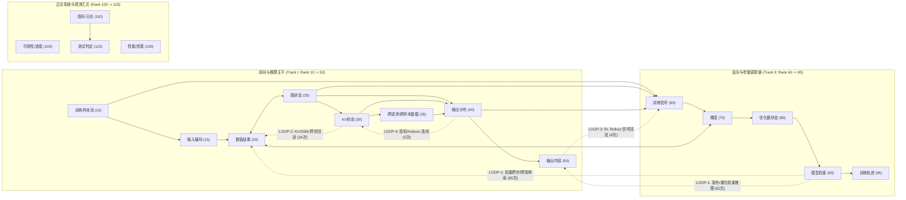

# LLM 全生命周期二分因果拓扑定稿（v1.0）与全库映射体检报告

**快照基线**：[SOURCES.txt](../catalogs/SOURCES.txt)（`2026-11-17T14:49:54+08:00`）
- `inference_error_review` `@ 5568770`：**2,508 条**（`故障` 2,491 · `结论` 8 · `方法` 8 · `指针` 1）
- `training_error_review` `@ 30b173b`：**764 条**（`故障` 757 · `统计` 3 · `方法` 2 · `结论` 2）
- 合计结构化条目：**3,272 条**（全部 `status: active`），活跃模式层 **279 个**（`PAT-INF` 202 · `PAT-TRN` 77）
- 机器可读规范与复现实验：[causal_topology.json](causal_topology.json) · [audit_topology.py](audit_topology.py) · [test_topology.py](test_topology.py)

---

## 一、拓扑定稿规范（v1.0）：双平面二分有向图 + 5 条显式反馈环

为消除「横切底座与阶段流水线平铺导致的毛球图」，并与 [vocab.yaml](../normalize/vocab.yaml) v1.3 保持 **1:1 严格枚举对齐（零增删字段）**，全生命周期因果图定义为四元组 $\mathcal{G} = (\mathcal{S}, \mathcal{C}, \mathcal{M}, \mathcal{E})$：

1. **阶段切面 $\mathcal{S}$（6 个宏观阶段）**：`pretrain` → `sft` → `rl`（Rollout ⇄ Learner 闭环）→ `ckpt_export`（重分片/转换/PTQ 静态桥）→ `serving`（Prefill ⇄ Decode ⇄ Parser）+ 横切 `eval_obs`（测试与监控平面）。
2. **传播平面 $\mathcal{C}$（17 个 `effect_object` 状态/观测载体）**：赋予严格单调的**单步因果拓扑秩 $\tau(c) \in [10, 115]$**，使得所有单步前向/反向传播边严格满足 $\tau(u) < \tau(v)$（已由 [test_topology.py](test_topology.py#L29-L41) 单元测试证明无环）。
3. **注入平面 $\mathcal{M}$（26 个 `subsystem` 缺陷归属域）**：划分为 3 类横向流水线域（`pipeline_train` / `pipeline_shared` / `pipeline_serving`）与 3 类正交支撑域（`substrate_compute` / `substrate_distributed` / `cross_cutting_meta`），每个子系统明确定义**物理直连载体（`primary_carriers`）**与**跨层简写载体（`secondary_carriers`）**。
4. **受控回边集 $\mathcal{E}_{\text{loop}}$（5 条跨步/跨阶段真实物理反馈环） + 7 对同层微耦合对**：把所有合法逆秩边显式隔离在受阶段门控的反馈环中，从而将真正的**编目因果逆序缺陷**（如 `输出内容 → 模型权重`）100% 暴露出来。

> [!IMPORTANT]
> **每个状态载体节点均已绑定标准「二分排查探针（Diagnostic Probe）」**（定义见 [causal_topology.json](causal_topology.json#L51-L185)）。例如当观测到 `输出内容 (50)` 异常时，拓扑探针先对比引擎原始输出 token IDs 与序列化响应以隔离 `输出解析`，再锁定 `temperature=0` 首步 `输出分布 (40)` 对拍，沿主干做对数级二分定位。

### 26 个 `subsystem` 的六平面归属与实测注入规模

| 平面分类 | 包含子系统（括号内为 `INF+TRN` 故障注入总频次） | 拓扑角色 |
|---|---|---|
| `pipeline_train` | `RL训练回路` (96) · `优化器` (50) · `数据管线` (47) · `损失计算` (35) | 仅向训练样本/信号/梯度/权重链注入 |
| `pipeline_shared` | `权重/检查点` (91) · `MoE路由` (76) · `模型定义` (70) · `位置编码` (55) · `分词/模板` (43) | 训推共用建模与参数桥，含 RoPE 反向直连 `梯度` |
| `pipeline_serving` | `KV缓存` (386) · `解码/采样` (162) · `调度/服务` (99) · `输出解析` (72) | 推理状态管理与后处理（RL Rollout 时耦合进训练） |
| `substrate_compute` | `算子/内核` (1,011) · `量化` (274) · `编译器` (222) · `运行时/执行` (154) · `硬件` (19) | 纵向计算底座，占全库故障注入量的 **51.5%** |
| `substrate_distributed` | `并行切分` (73) · `集合通信` (56) · `重计算/卸载` (28) | 多卡切分归约与显存换算层（TP/PP/DP/EP/CP） |
| `cross_cutting_meta` | `观测/评测` (91) · `外部攻击` (18) · `模型自身` (15) · `配置/参数` (10) · `构建/发布` (6) | 外部监控门禁、配置传递、打包与对抗篡改 |

---

## 二、全库 3,272 条结构化条目七维映射体检结果

### 体检 1：节点与边绑定完备度 —— **99.54% 零占位符直通**

3,248 条 `kind: 故障` 条目形成严格互斥完备划分（`3,233 + 12 + 1 + 2 = 3,248`）：

| 映射状态 | 条目数 | 占比 | 具体定位与处置价值 |
|---|---:|---:|---|
| **完整映射（无 `待定`）** | **3,233** | **99.54%** | `cause.subsystem` 与全部 `effect.objects` 均精确落入拓扑节点 |
| **根因待定悬案（`subsystem: 待定`）** | **12** | **0.37%** | 推理库 11 条 + 训练库 1 条（表象已记录、根因未定位，天然作为反向溯因测试集） |
| **影响完全待定（`effect: [待定]`）** | **1** | **0.03%** | `inference` `INF-0495 vllm_lazydict_setitem_cache_invalidation_missing`（[INF-0495.yaml](../catalogs/inference/entries/INF-0495.yaml)，`documented`） |
| **尾部次级影响待定** | **2** | **0.06%** | `inference` `INF-0019 ttmetal_erisc_byte_vs_word_count_overcopy`（[INF-0019.yaml](../catalogs/inference/entries/INF-0019.yaml)，`documented`，`[可用性/进度, 待定]`）；`inference` `INF-0498 trtllm_cluster_storage_get_prefix_ttl_bypass`（[INF-0498.yaml](../catalogs/inference/entries/INF-0498.yaml)，`documented`，`[KV状态, 待定]`） |

> [!TIP]
> **对 12 条 `subsystem: 待定` 悬案运行图祖先先验溯因的效果验证**：若只按字面首项 `effect[0] == 输出内容` 统计，直接先验会把 `输出解析` 排第一；而沿因果图汇合所有可达祖先路径后，悬案如 `inference` `INF-0608 vllm_dsv4flash_deep_context_exact_retrieval_mod4_prompt_length_wrong_token`（[INF-0608.yaml](../catalogs/inference/entries/INF-0608.yaml)，`verified`）自动给出物理合理的候选分布：`KV缓存 (20.2%) > 算子/内核 (12.0%) > 量化 (11.8%) > 解码/采样 (11.4%)`；并发串扰悬案 `inference` `INF-0544 sglang_dflash2_concurrent_cross_request_context_bleed`（[INF-0544.yaml](../catalogs/inference/entries/INF-0544.yaml)，`speculative`）则直接收敛至 `KV缓存 (52.7%) > 算子/内核 (13.4%) > 调度/服务 (9.8%)`；训练侧唯一悬案 `training` `TRN-0136 framework_version_drift_silent_loss_divergence`（[TRN-0136.yaml](../catalogs/training/entries/TRN-0136.yaml)，`documented`）收敛至 `RL训练回路 / 损失计算 / 算子/内核`。

---

### 体检 2：子系统注入边界吻合度 —— **99.91% 符合模块物理契约，仅 3 条越界（且全部源于逆序）**

全库共产生 **3,255 次**有效 `subsystem → effect.objects[0]` 注入（覆盖 `26 × 17 = 442` 格矩阵中的 **213 个非零单元，密度 48.2%**）：

- **物理直连注入（`direct_injection`）**：**2,883 次（88.57%）** —— 首项影响正是该模块代码的直接输出边界（如 `算子/内核 → 数值结果` 794 次、`KV缓存 → KV状态` 235 次、`位置编码 → 梯度` 覆盖 RoPE 反向算子如 `training` `TRN-0140 triton_block_local_mask_oob_rope_write` [TRN-0140.yaml](../catalogs/training/entries/TRN-0140.yaml) `documented`、`解码/采样 → 隐状态` 覆盖投机解码辅助层捕获 `inference` `INF-2419 dspark_aux_state_one_based_capture_misalignment` [INF-2419.yaml](../catalogs/inference/entries/INF-2419.yaml) `documented`）。
- **跨层简写注入（`shortcut_injection`）**：**368 次（11.31%）** —— 条目省略了中间张量，直接把终端表象写在首位（前五名：`量化 → 输出内容` 33、`运行时/执行 → 输出内容` 31、`调度/服务 → 输出内容` 27、`算子/内核 → 输出内容` 25、`KV缓存 → 输出内容` 25）。**这证明反向溯因决不能只查直接相连的 1 跳边，必须在状态主干上做传递闭包遍历。**
- **多子系统配对注入（`joint_paired_injection`）**：**1 次（0.03%）** —— `inference` `INF-0156 ttmetal_rpow_bw_differentiates_x_base_instead_of_base_x`（[INF-0156.yaml](../catalogs/inference/entries/INF-0156.yaml)，`verified`），`cause=[算子/内核, 观测/评测]` 分别对应 `effect=[梯度, 测试判定]`。
- **注入边界违例（`boundary_violation`）**：**仅 3 次（0.09%）** —— 全部发生在 `模型定义 → 训练轨迹`：
  - `training` `TRN-0165 unscaled_embedding_grad_spike`（[TRN-0165.yaml](../catalogs/training/entries/TRN-0165.yaml)，`documented`，`effect=[训练轨迹, 梯度]`）
  - `training` `TRN-0166 attention_logit_growth_without_qk_norm`（[TRN-0166.yaml](../catalogs/training/entries/TRN-0166.yaml)，`documented`，`effect=[训练轨迹, 隐状态]`）
  - `training` `TRN-0167 post_ln_vanishing_then_explode`（[TRN-0167.yaml](../catalogs/training/entries/TRN-0167.yaml)，`documented`，`effect=[训练轨迹, 梯度]`）
  三者均因把宏观终端后果 `训练轨迹` 倒置在了直接机制 `梯度` / `隐状态` 之前而触发告警。

---

### 体检 3：多状态传播拓扑序审计 —— **99.94% 被拓扑解释，精准抓出 234 条因果倒置**

对全库 `effect.objects` 长度 $\ge 2$ 的条目共 **1,661 次相邻状态转移**做分类检验：

| 转移类别 | 频次 | 占比 | 典型高频转移对 |
|---|---:|---:|---|
| **`canonical_forward`（标准前向骨干）** | 976 | 58.76% | `KV状态→输出内容` (157)、`数值结果→输出内容` (128)、`隐状态→输出内容` (61)、`数值结果→可用性/进度` (48)、`输出分布→输出内容` (47) |
| **`intra_step_coupled`（同层紧耦合）** | 269 | 16.20% | `数值结果↔隐状态` (87)、`数值结果↔梯度` (74)、`KV状态↔跨请求/跨样本数据` (50)、`可用性/进度↔性能/资源` (25) |
| **`feedback_loop`（5 条合法跨步闭环）** | 159 | 9.57% | `模型权重→输出内容` (50)、`KV状态→数值结果` (20)、`KV状态→隐状态` (14)、`模型权重→输出分布/训练信号` (各 12)、`数值结果→训练样本流` (6，如 `training` `TRN-0436 opsmath_randperm_dtype_boundary_whole_output_unwritten` [TRN-0436.yaml](../catalogs/training/entries/TRN-0436.yaml) `documented`) |
| **`abort_recovery_corruption`（中断/恢复污染）** | 19 | 1.14% | 调度/运行时抢占或取消竞态引发状态损坏（如 `可用性/进度→KV状态` 8 次） |
| **`causal_inversion`（因果倒置缺陷）** | **234** | **14.09%** | **终端表象被误排在物理成因之前（涉及 234 条条目，详见下方拆解）** |
| **`placeholder` / `self_duplicate` / `unmodeled`** | 4 | 0.24% | 含 `待定` 2 次；重复项 1 次；未建模共因缓存 1 次 |

> [!WARNING]
> **编目治理高价值发现：234 条 `effect.objects` 因果倒置 + 4 条重复枚举缺陷**
> [vocab.yaml](../normalize/vocab.yaml#L152) 规定 `effect.objects 第一项写最直接变错的东西`，但历史迁移与扫描中约 14% 的多影响条目按「用户感知显著度」写反了顺序：
> - **`输出内容` 倒置在中间状态前（94 次）**：`输出内容→输出分布` (30)、`输出内容→数值结果` (18，如 `inference` `INF-0243 ttmetal_approx_tanh_sfplut_reland_e2e_vision_quality_regression_below_gate` [INF-0243.yaml](../catalogs/inference/entries/INF-0243.yaml) `verified` 与 `inference` `INF-0317 fp_reduction_order_nondeterminism` [INF-0317.yaml](../catalogs/inference/entries/INF-0317.yaml) `verified`)、`输出内容→隐状态` (18)、`输出内容→KV状态` (18，如 `inference` `INF-0460 sglang_chunked_prefill_final_abort_commit_race` [INF-0460.yaml](../catalogs/inference/entries/INF-0460.yaml) `documented`)、`输出内容→模型权重` (9，全部为 Rowhammer 权重位翻转攻击如 `inference` `INF-0297 prisonbreak_bitflip_jailbreak` [INF-0297.yaml](../catalogs/inference/entries/INF-0297.yaml) `verified`，物理上直接篡改的是 `模型权重`)。
> - **崩溃表象倒置在越界数值前（15 次）**：`可用性/进度→数值结果`（如 `inference` `INF-0227 vllm_staged_write_tensor_apply_write_int32_row_offset_wraparound` [INF-0227.yaml](../catalogs/inference/entries/INF-0227.yaml) `verified`，int32 偏移溢出先算错地址再触发访存崩溃）。
> - **评测结论/训练轨迹倒置在机制前**：`测试判定→指标/日志` (13)、`梯度→训练信号` (10)、`训练轨迹→梯度/隐状态`（如 `training` `TRN-0123 selective_recompute_stale_rng` [TRN-0123.yaml](../catalogs/training/entries/TRN-0123.yaml) `documented` 与 `training` `TRN-0008 sdc_forward_qk_backward_grad_exponent` [TRN-0008.yaml](../catalogs/training/entries/TRN-0008.yaml) `documented`）。
> - **唯一未建模转移（1/1,661 = 0.06%）**：`inference` `INF-0933 hf_cached_files_erofs_silent_stale_return`（[INF-0933.yaml](../catalogs/inference/entries/INF-0933.yaml)，`documented`），`模型权重→输入编码`，实为 HF 本地缓存同时返回旧权重与旧分词配置的并列共果（Co-effect）。

---

### 体检 4：多对象超边与重复字段卫生检查

- **真实跨子系统联合契约故障（超边）共 18 条**：修复确实横跨两个模块，典型模式是「算子缺陷 + 同错测试 golden 掩盖」（5 条，如 `INF-0156`）、「运行时进程崩溃 + 调度健康探针假活」（2 条）及「并行切分 + 损失归约错配」（如 `training` `TRN-0094 sp_shard_cuts_causal_lm_labels` [TRN-0094.yaml](../catalogs/training/entries/TRN-0094.yaml)，`verified`）。
- **检出 4 条数组内重复枚举缺陷**（违反 [vocab.yaml](../normalize/vocab.yaml#L151) 合并规则，可在上游 `validate` 增加去重校验）：
  1. `training` `TRN-0443 opsmath_cumsum_default_nondeterministic_bitpatterns`（[TRN-0443.yaml](../catalogs/training/entries/TRN-0443.yaml)，`documented`）：`effect.objects` 写了两次 `['数值结果', '数值结果']`。
  2. `inference` `INF-0353 distributed_seed_not_broadcast`（[INF-0353.yaml](../catalogs/inference/entries/INF-0353.yaml)，`documented`）：`cause.objects` 写了两次 `并行切分`。
  3. `inference` `INF-0935 sglang_simulate_acc_len_fill100_byte_fallback_detoken_o_n_squared`（[INF-0935.yaml](../catalogs/inference/entries/INF-0935.yaml)，`documented`）：`cause.objects` 写了两次 `分词/模板`。
  4. `inference` `INF-1096 qwen4exp_dflash_dspark_drafter_serving_five_blockers`（[INF-1096.yaml](../catalogs/inference/entries/INF-1096.yaml)，`verified`）：`cause.objects` 含重复 `['模型定义', '运行时/执行', '模型定义']`。

---

### 体检 5：真实生命周期阶段重映射与 120 对跨库 `cross` 边解构

1. **发现 `inference` 编目内隐含 74 条「纯训练反向/优化器/损失」条目（其中 67 条无 `cross` 关联）**
   按仓库扫描（`tt-metal` 24 条、`mindspore` 13 条、`cann` 12 条、`pytorch` 10 条）把大量纯训练路径缺陷录入了 `INF-*`，例如：
   - 反向算子：`inference` `INF-0107 ttmetal_pow_bw_negative_base_composite_log_nan_inf`（[INF-0107.yaml](../catalogs/inference/entries/INF-0107.yaml)，`verified`）
   - 优化器实现：`inference` `INF-0193 ttmetal_moreh_adam_bf16_hyperparameter_truncation_wrong_optimizer`（[INF-0193.yaml](../catalogs/inference/entries/INF-0193.yaml)，`verified`）
   - 损失函数：`inference` `INF-0199 ttmetal_loss_preallocated_output_repurposed_as_unreduced_intermediate`（[INF-0199.yaml](../catalogs/inference/entries/INF-0199.yaml)，`verified`）
   **结论**：在因果图上必须按条目的**实际因果落点（Effective Stage）**而非仓库前缀 `INF`/`TRN` 挂载节点——否则在训练侧排查 `梯度` / `优化器状态` 异常时会漏掉这 67 条 `INF-*` 案例。

2. **训练库内 11 条触及推理组件的条目全部验证为真实物理耦合**
   - **RL 在线采样-训练闭环**：如 `training` `TRN-0726 trl_asyncgrpo_prefix_cache_stale_kv_weight_sync`（[TRN-0726.yaml](../catalogs/training/entries/TRN-0726.yaml)，`documented`，权重同步后前缀缓存残留旧权重 KV）、`training` `TRN-0379 vllm_ascend_rl_sampler_q_premature_reuse`（[TRN-0379.yaml](../catalogs/training/entries/TRN-0379.yaml)，`documented`）、`training` `TRN-0549 trl_parse_response_qwen35_unclosed_think_region`（[TRN-0549.yaml](../catalogs/training/entries/TRN-0549.yaml)，`documented`，工具解析吞调用直接污染 RL reward）。
   - **线性注意力训练态块缓存**：`training` `TRN-0292 megatron_gdn_graph_fla_tensor_cache_uaf`（[TRN-0292.yaml](../catalogs/training/entries/TRN-0292.yaml)，`documented`）。

3. **120 对跨库 `cross` 关联双向对称率 100%（0 悬空/单向），但严重偏向底座共因**
   - **共享底座共因分叉（`common_substrate`）**：**116 对（96.7%）** —— 如 `training` `TRN-0280 triton_ascend_static_rnumel_miscompile`（[TRN-0280.yaml](../catalogs/training/entries/TRN-0280.yaml)，`documented`）↔ `inference` `INF-1375 triton_ascend_static_rnumel_softmax_miscompile`（[INF-1375.yaml](../catalogs/inference/entries/INF-1375.yaml)，`documented`）；`training` `TRN-0282 add_rms_norm_tiling_mode_bypass_silent`（[TRN-0282.yaml](../catalogs/training/entries/TRN-0282.yaml)，`documented`）↔ `inference` `INF-1382 cann_ops_nn_add_rms_norm_950_prepost_mode_silent`（[INF-1382.yaml](../catalogs/inference/entries/INF-1382.yaml)，`documented`）；`training` `TRN-0336 mindspeed_te_rowparallel_parallel_mode_none_still_comm`（[TRN-0336.yaml](../catalogs/training/entries/TRN-0336.yaml)，`documented`）↔ `inference` `INF-0373 sglang_gptoss_dp_attention_double_reduction_allreduce_scatterv`（[INF-0373.yaml](../catalogs/inference/entries/INF-0373.yaml)，`verified`）。
   - **跨阶段权重继承桥（`state_inheritance`）**：**仅 3 对（2.5%）** —— `TRN-0005 training_sdc_checkpoint_inherit`（[TRN-0005.yaml](../catalogs/training/entries/TRN-0005.yaml)，`documented`）↔ `INF-0006 training_sdc_checkpoint_inherit`（[INF-0006.yaml](../catalogs/inference/entries/INF-0006.yaml)，`verified`）；`TRN-0050 expert_reshard_id_permutation`（[TRN-0050.yaml](../catalogs/training/entries/TRN-0050.yaml)，`documented`）↔ `INF-0352 ep_checkpoint_shard_mismatch`（[INF-0352.yaml](../catalogs/inference/entries/INF-0352.yaml)，`documented`）；`TRN-0052 from_pretrained_silent_random_init`（[TRN-0052.yaml](../catalogs/training/entries/TRN-0052.yaml)，`documented`）↔ `INF-1118 from_pretrained_silent_random_init`（[INF-1118.yaml](../catalogs/inference/entries/INF-1118.yaml)，`verified`）。
   - **RL 训推采样耦合桥（`rl_rollout_coupling`）**：**仅 1 对（0.8%）** —— `TRN-0505 vllm_ascend_v1_sampler_logprobs_mode_rl`（[TRN-0505.yaml](../catalogs/training/entries/TRN-0505.yaml)，`documented`）↔ `INF-2250 vllm_ascend_sampler_logprobs_mode_not_forwarded`（[INF-2250.yaml](../catalogs/inference/entries/INF-2250.yaml)，`documented`）。

---

### 体检 6：279 个 `PAT-*` 模式族在拓扑图上的凝聚度

当前 843 条故障归入 279 个 `PAT-*` 模式（覆盖率 26.0%）：
- **单点高凝聚模式（153 个，54.8%）**：子系统一致度 $\ge 0.70$ 且首项状态载体一致度 $\ge 0.55$，在因果图上可直接折叠为**单条注入边上的聚合簇**。
- **跨模块机制模式 vs 链式漂移模式（规模 $\ge 3$ 的低纯度模式共 54 个）**：拓扑投影自动区分出两类情形——
  - **合理横切元模式**：如 `PAT-TRN-0001`（配置声明未生效，横跨 7 个子系统）与 `PAT-INF-0003`（浮点归约顺序非确定性，横跨 `算子/内核`/`编译器`/`量化`），属于正交机制模板，不应强绑单一模块节点。
  - **边界耦合 / 链式漂移候选**：如 `PAT-INF-0060`（KV scale 在 `量化`/`权重/检查点`/`KV缓存` 三界丢失）和 `PAT-INF-0069`（LoRA 控制视图与执行态失配），可视作跨模块契约超边模式。

---

### 体检 7：静默故障暴露度与检测盲区雷达（最高优先级治理清单）

定义载体的**未设防静默暴露指数** $\text{Exposure}(c) = N_{\text{silent}}(c) \times (1 - \text{Cov}_{\text{detect}\cup\text{sig}}(c))$，全库 17 个状态载体的风险排序揭示出三大结构性盲区：

| 排名 | 状态载体 | 拓扑秩 | 关联故障数 | 静默错误率 | `detect ∪ sig` 覆盖率 | 库内 `方法` 条目数 | 未设防静默暴露指数 |
|---:|---|---:|---:|---:|---:|---:|---:|
| 1 | `数值结果` | 20 | 1,413 | 80.8% | 68.2% | 2 (`FP-Sketch` 等) | **363.7** |
| 2 | `输出内容` | 50 | 869 | 67.1% | 49.8% | 3 | **292.5** |
| 3 | `KV状态` | 30 | 342 | 68.4% | 55.3% | 2 (`KVGuard` 等) | **104.7** |
| 4 | `模型权重` | 90 | 229 | 76.9% | 43.7% | 4 (`RangeGuard`/`SPINE` 等) | **99.1** |
| 5 | `梯度` | 70 | 285 | 76.1% | 61.4% | 2 (`SCOUT`/`FP-Sketch`) | **83.8** |
| 6 | `训练轨迹` | 95 | 142 | 68.3% | **32.4%** | 1 | **65.6** |
| 7 | `隐状态` | 25 | 213 | 65.3% | 58.2% | 1 | **58.1** |
| 8 | `训练信号` | 60 | 168 | 75.0% | 58.3% | **0** | **52.5** |
| 9 | `输出分布` | 40 | 191 | 57.6% | 52.4% | **0** | **52.4** |
| 10 | `跨请求/跨样本数据` | 35 | 127 | **83.5%** | 52.0% | 2 (`GRIEF`/`KVGuard`) | **50.9** |
| 11 | `输入编码` | 15 | 73 | **82.2%** | **30.1%** | **0** | **41.9** |

> [!NOTE]
> **三大检测与编目盲区结论**：
> 1. **源头裸奔点 `输入编码 (Rank 15)` 与 `分词/模板`**：静默率高达 **82.2%**，但检测/签名覆盖率仅 **30.1%**（`分词/模板` 子系统的 `mitigation.detect` 填写率全库最低之一，仅 **14.0%**），且全库 **`kind: 方法` 条目为 0**。源头编码一旦静默错位（如训推 chat template、特殊 token、多模态归一化不一致），下游算子与模型完全健康也会产出错误结果。
> 2. **RL 闭环核心载体 `训练信号 (Rank 60)` 与 `输出分布 (Rank 40)` 方法论空白**：两者合计 **359 条关联故障**（如 logprobs 漂移、advantage/KL 归约失真），但库内 `kind: 方法` 检测器条目均为 **0**（现有 10 条方法条目集中在硬件 SDC 权重位翻转 `INF-0308` [INF-0308.yaml](../catalogs/inference/entries/INF-0308.yaml) `documented`、KV 内存安全 `INF-2467` [INF-2467.yaml](../catalogs/inference/entries/INF-2467.yaml) `documented`、服务并发模糊测试 `INF-0514` [INF-0514.yaml](../catalogs/inference/entries/INF-0514.yaml) `documented` 与预训练副本共识 `TRN-0007` [TRN-0007.yaml](../catalogs/training/entries/TRN-0007.yaml) `documented` / `TRN-0009` [TRN-0009.yaml](../catalogs/training/entries/TRN-0009.yaml) `documented`）。
> 3. **训推交界 `ckpt_export` 与 `RL rollout↔train` 的跨库关联（`cross`）覆盖偏低**：120 对跨库边中 96.7% 来自底层算子/编译器共因，而「SFT/RL 模板与权重转换 → 线上推理退化」以及「vLLM/SGLang 采样/前缀缓存缺陷 → RL 训练信号崩坏」的显式 `cross` 桥接目前仅有 4 对，存在大量可自动挖掘配对的潜在线索。

---

## 三、落地产物与建议决策项

本次定稿已在 `fault_review/topology/` 下生成纯标准库可运行的完整套件（未改动 `catalogs/` 或上游只读编目仓库）：
- 拓扑定稿定义：[causal_topology.json](causal_topology.json)
- 全库七维体检器：[audit_topology.py](audit_topology.py)
- 严格拓扑秩与词表对齐测试：[test_topology.py](test_topology.py)（6 项不变量测试全部通过）

### 待确认的三个工程决策

1. **上游编目卫生修复（可选批处理）**：是否需要将本次体检抓出的 **4 条重复枚举缺陷**（`TRN-0443`、`INF-0353`、`INF-0935`、`INF-1096`）和 **234 条 `effect.objects` 因果倒置条目**生成一份供上游 `catalog_tool.py update` / `validate` 使用的修正清单与校验规则？
2. **训练算子跨库归属策略**：`inference` 库内的 **74 条纯训练反向/优化器/损失条目**（如 `ttnn.*_bw`、`moreh_adam`），在可视化与溯因引擎中是采用**「不搬迁条目、由拓扑层按 Effective Stage 动态挂载到训练回路」**（推荐，零上游改动），还是迁回训练编目？
3. **进入第二步可视化集成**：确认当前 v1.0 拓扑结构后，即可在 `fault_review/web/build_site.py` 中接入 `causal_topology.json` 导出前端图数据，构建支持按 `stack` / 阶段 / 静默率切片并联动 `PAT-*` 与条目检索的交互式因果地图页。
